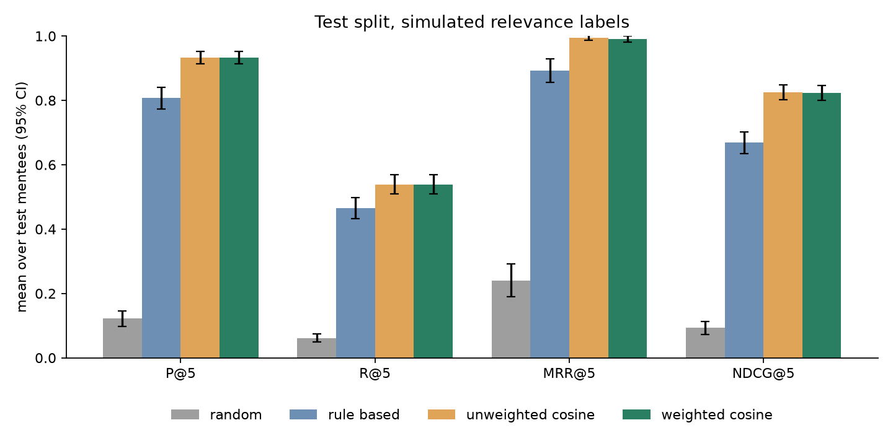

# Test-split evaluation (simulated labels)

Generated: 2026-09-17T10:44:43+00:00  
Tuned weights: `{"text": 0.4, "skills": 0.3, "specialisation": 0.3}` (config version `d1316c5b80`)  
K = 5; relevant = grade >= 1; NDCG uses graded labels (0/1/2).  
Test mentees evaluated: 176 (skipped: 4 incomplete profiles, 0 with no relevant eligible mentor).

> **These labels are simulated.** The results show whether the pipeline recovers the signal built into the
> synthetic generator and how the methods compare under those assumptions. They are not evidence that the
> recommendations suit real Kenya Airways mentors and Pride Centre alumni; that requires expert or participant
> relevance judgements (see `ratings/`).

## Main comparison (mean ± 95% CI half-width)

| System | precision@5 | recall@5 | mrr@5 | ndcg@5 |
|---|---|---|---|---|
| random | 0.122 ± 0.023 | 0.061 ± 0.012 | 0.241 ± 0.051 | 0.093 ± 0.021 |
| rule_based | 0.807 ± 0.034 | 0.465 ± 0.033 | 0.893 ± 0.037 | 0.668 ± 0.034 |
| unweighted_cosine | 0.933 ± 0.019 | 0.539 ± 0.030 | 0.994 ± 0.008 | 0.825 ± 0.023 |
| weighted_cosine | 0.933 ± 0.019 | 0.539 ± 0.030 | 0.991 ± 0.010 | 0.823 ± 0.024 |

## Ablations

| System | precision@5 | recall@5 | mrr@5 | ndcg@5 |
|---|---|---|---|---|
| text_only | 0.647 ± 0.043 | 0.352 ± 0.026 | 0.860 ± 0.045 | 0.556 ± 0.039 |
| skills_only | 0.688 ± 0.053 | 0.381 ± 0.033 | 0.811 ± 0.054 | 0.602 ± 0.048 |
| weighted_no_glossary | 0.933 ± 0.020 | 0.539 ± 0.030 | 0.994 ± 0.008 | 0.821 ± 0.023 |
| weighted_policy_renormalise_content | 0.931 ± 0.019 | 0.539 ± 0.030 | 0.983 ± 0.013 | 0.815 ± 0.024 |
| weighted_policy_renormalise | 0.933 ± 0.019 | 0.541 ± 0.031 | 0.983 ± 0.013 | 0.814 ± 0.024 |
| weighted_policy_zero | 0.933 ± 0.019 | 0.539 ± 0.030 | 0.991 ± 0.010 | 0.823 ± 0.024 |

## Paired Wilcoxon signed-rank tests on NDCG@5 (weighted_cosine vs. each system)

| Compared with | Mean difference | p-value | Pairs |
|---|---|---|---|
| random | +0.731 | 1.2e-30 | 176 |
| rule_based | +0.155 | 5.2e-16 | 176 |
| skills_only | +0.222 | 9.4e-20 | 176 |
| text_only | +0.268 | 1.6e-24 | 176 |
| unweighted_cosine | -0.001 | 0.72 | 176 |
| weighted_no_glossary | +0.002 | 0.62 | 176 |
| weighted_policy_renormalise | +0.009 | 0.18 | 176 |
| weighted_policy_renormalise_content | +0.008 | 0.032 | 176 |
| weighted_policy_zero | +0.000 | 1 | 176 |

